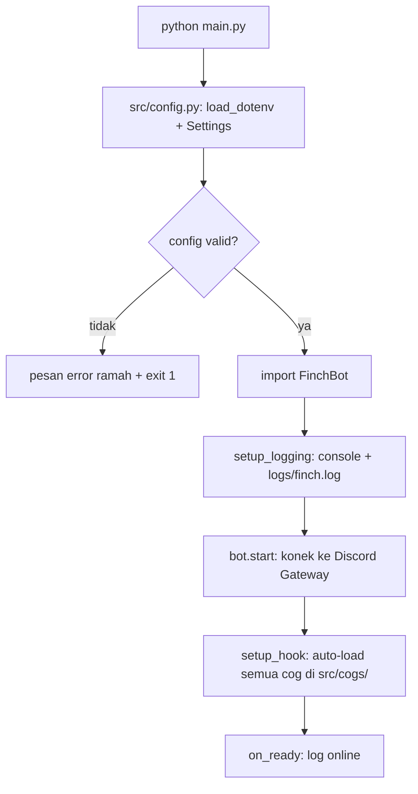

# ARCHITECTURE — Finch

> Desain teknis bot. Baca ini kalau mau paham "kenapa kodenya disusun begini"
> sebelum refactor besar atau nambah subsistem baru (database, dashboard, dsb).

## 1. Gambaran besar

Finch adalah bot Discord berbasis **discord.py** (asyncio). Arsitekturnya sederhana
dan disengaja: satu proses, tanpa database (v1), semua state moderasi di memori.

```
Discord Gateway (websocket)
        │ event: message, member join, ...
        ▼
   ┌──────────┐
   │ FinchBot │  src/bot.py — commands.Bot + intents + event handler
   └────┬─────┘
        │ dispatch
        ▼
   ┌──────────┐
   │   Cogs   │  src/cogs/ — satu file = satu area fitur
   └────┬─────┘
        │ Discord API (kirim pesan, hapus pesan, ...)
        ▼
     Server
```

## 2. Alur startup



Catatan desain: `src/bot.py` (butuh `discord`) sengaja di-import **setelah**
validasi config, supaya user yang lupa isi token dapat pesan yang jelas
walau `discord.py` belum ter-install.

## 3. Modul

| Modul | Tanggung jawab | Boleh import |
|---|---|---|
| `main.py` | Entry point tipis: validasi → logging → start | `src.config`, `src.bot` |
| `src/config.py` | `Settings` dataclass, baca `.env` sekali saat import | `os`, `dotenv` |
| `src/store.py` | Persistensi SQLite di `data/finch.db` (users, warnings, mutes, tickets, giveaways, polls, reminders, yt_posts, tempvc, suggestions, invites_log, economy, counting_state, quest_progress, server_pool, lotre_tiket, gaji_state, lelang, lelang_bid, achievement, autoresponder, birthday, sticky, bump, events, event_rsvp, season_state, giveaway_rutin, poll_rutin, reminder_rutin, twitch_live, voice_total, tiket_rating) | `sqlite3`, `os` |
| `src/cogs/leveling.py` | Sistem Level/XP: otomatis kirim XP di `on_message`, `/level` cek status | `src.config`, `src.store`, `src.utils` |
| `src/bot.py` | `FinchBot`: intents, `setup_hook` (init_db, load cog), `on_ready`, `on_member_join` (welcome), `on_member_remove` (log) | `src.config`, `src.cogs`, `src.utils`, `src.store` |
| `src/cogs/*.py` | Fitur per area. Wajib ada `async def setup(bot)` | `src.config`, `src.utils` |
| `src/cogs/verification.py` | Panel + tombol persistent: klik "Verifikasi" → role verified | `src.config`, `src.utils` |
| `src/cogs/moderation.py` | Anti-spam + anti-invite-link + `!bersihkan`, semua di-log | `src.config`, `src.utils` |
| `src/utils/*.py` | Helper: `embeds.py` (tampilan), `filters.py` (deteksi link + `parse_durasi`, murni/testable), `modlog.py` (kirim ke channel log), `views.py` (`TimeoutSafeView`), `rankcard.py` (kartu PNG), `xp.py` (`tambah_xp`, `beri_role_reward`) | `discord` / `src.config` saja |
| `tests/` | Unit test logika murni (tanpa koneksi Discord) | modul yang dites |

Aturan import: **cog tidak boleh import cog lain.** Kalau dua cog butuh logika
yang sama, pindahkan ke `src/utils/`.

## 4. Alur event & command

- **Command** (`!status`, `!bersihkan`): `discord.ext.commands` me-routing pesan
  ber-prefix ke fungsi command. Permission dijaga decorator
  (`@commands.has_permissions(...)`).
- **Listener** (`on_message` anti-spam, `on_member_join`): jalan di luar sistem
  command. ⚠️ Jangan override `on_message` di `FinchBot` tanpa
  `await self.process_commands(message)` — semua command akan mati.
- **Anti-spam**: `defaultdict[user_id, deque[timestamp]]` di memori.
  >5 pesan dalam 5 detik → hapus pesan + peringatan + auto-mute.
  Data riwayat disimpan ke SQLite di `src/store.py` (persisten, tidak hilang restart).
  User dengan permission `manage_messages` di-skip.
- **Anti-invite-link**: regex di `src/utils/filters.py` (murni, ada unit test).
  Link invite dari non-mod → dihapus + peringatan + catat mod-log.
- **Verifikasi**: `on_member_join` (cog verification) kasih role unverified;
  `on_raw_reaction_add` (✅ di channel verifikasi) tukar ke role verified.
  ⚠️ Role bot harus **di atas** role verifikasi di hierarki server,
  kalau tidak Discord menolak (`discord.Forbidden`) — sudah ditangani
  dengan log warning, bukan crash.

## 5. State & persistensi (v2)

| State | Disimpan di | Hilang saat restart? |
|---|---|---|
| Config | `.env` → `Settings` | Tidak |
| Riwayat anti-spam | memori (`deque`) | **Ya** — user bisa spam lagi tepat setelah restart |
| Log | `logs/finch.log` | Tidak (append) |
| Level/XP member | `data/finch.db` (`users`) | Tidak — persisten via SQLite |
| Cooldown aksi (nikah-klaim, confess) | `cooldown_aksi` | Tidak — persisten (Tahap 12 hotfix) |
| Peserta clan war | `clan_war_peserta` | Tidak — persisten (Tahap 12 hotfix) |
| Alert SLA tiket terkirim | `sla_warned` | Tidak — persisten (Tahap 12 hotfix) |
| (tabel `audit_logs` dihapus — tak pernah dipakai) | — | — |

Fitur persistensi (Leveling, Leaderboard) sudah jalan via `src/store.py`.
Fitur yang masih di memori (anti-spam) bisa di-migrate ke SQLite kalau butuh riwayat pelanggar antar-restart.

## 6. Keputusan desain penting

1. **Hybrid command (`!` + `/`) di v2** — prefix `!` tetap jalan buat user lama, `/` buat user modern.
   Sinkronisasi command tree via `setup_hook` (instant kalau `GUILD_ID` di-set).
2. **Config terpusat di `src/config.py`** — tidak ada `os.getenv` tersebar di
   cog. Nambah setting baru = tambah field di `Settings` + contoh di `.env.example`.
3. **Persistensi data via `src/store.py`** — jangan taruh query SQL di dalam cog,
   akses via `get_connection()`.
4. **Balasan user Bahasa Indonesia santai** — ini bagian dari identitas produk
   (lihat PRD), bukan sekadar gaya kode.
5. **Dashboard web lokal opsional** (Tahap 12, `src/cogs/utilitas.py`) — bind
   `127.0.0.1` di `DASHBOARD_PORT`, endpoint `/` + `/api/stats`. Tidak terekspos
   ke internet.
6. **Batas 100 top-level slash command** (Discord) — command dikelompokkan
   dalam `@commands.hybrid_group` (`/dagang`, `/game`, `/lomba`, …). Ketik nama
   grup saja untuk bantuan subcommand. Nambah command baru: masukkan ke grup
   yang ada bila cocok.
7. **Pola anti race untuk koin** — operasi koin yang bisa di-double-click
   (tombol/view) harus: (1) guard flag di awal handler, (2) set flag SEBELUM
   operasi DB; untuk jual-beli pakai guarded `UPDATE ... WHERE balance >= ?`
   + INSERT dalam satu transaksi.
6. **Auto-restart** — gunakan `run.bat` (Windows) atau `run.sh` (Linux) biar
   bot otomatis hidup lagi jika crash.

## 7. Kalau mau kembangin, mulai dari sini

- Fitur moderasi/komunitas baru → file baru di `src/cogs/` (pola: tiru `verification.py`).
- Setting baru → field di `Settings` + `.env.example` + test di `tests/test_config.py`.
- Tampilan embed baru → helper di `src/utils/embeds.py`.
- Kejadian yang perlu diaudit → `await modlog.log_event(...)`, jangan kirim manual.
- Logika teks murni (filter, parsing) → `src/utils/filters.py` + unit test,
  jangan campur dengan kode Discord API.
- Butuh ingat data antar-restart → SQLite di `data/`, akses via modul baru
  `src/store.py` (jangan taruh query SQL di dalam cog).
